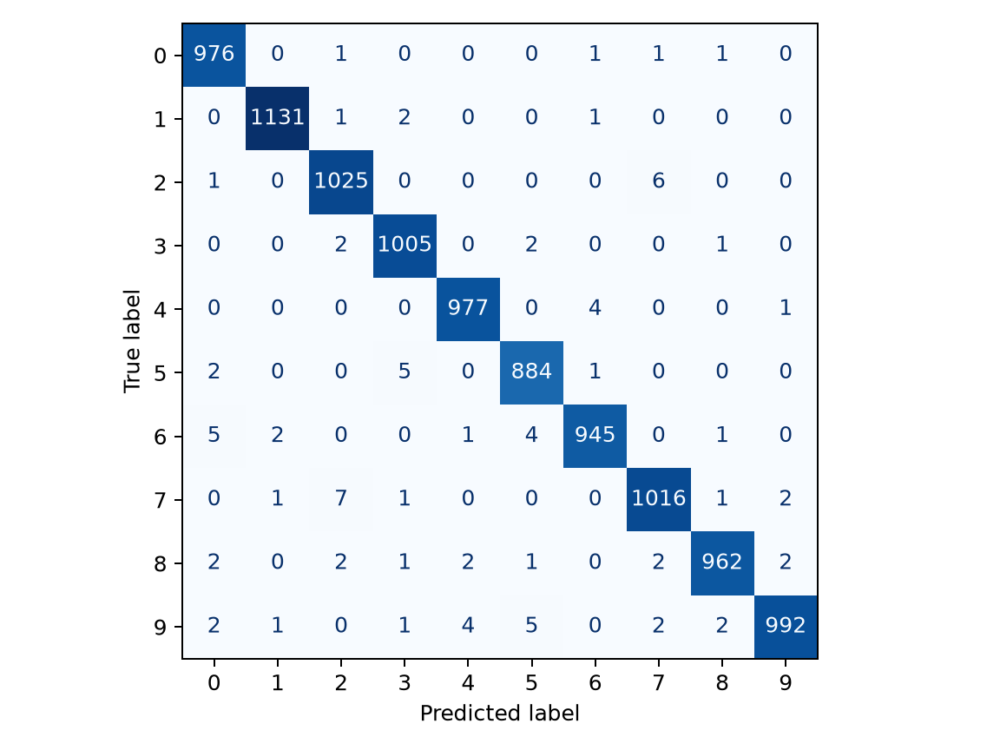
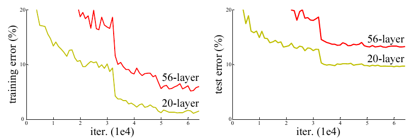
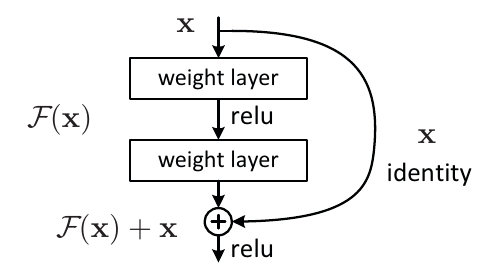
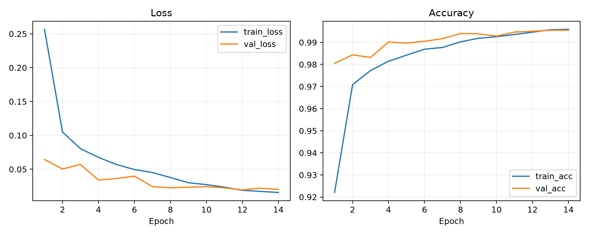
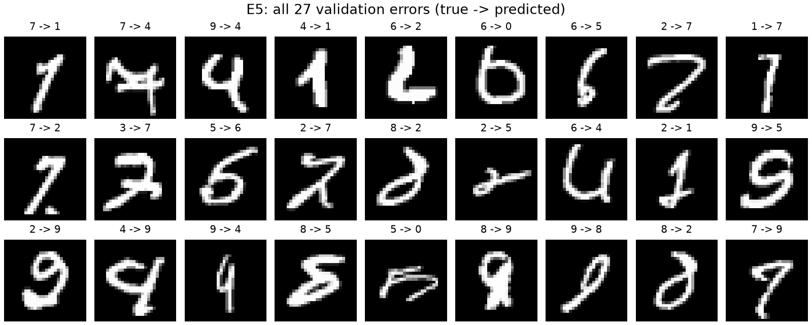
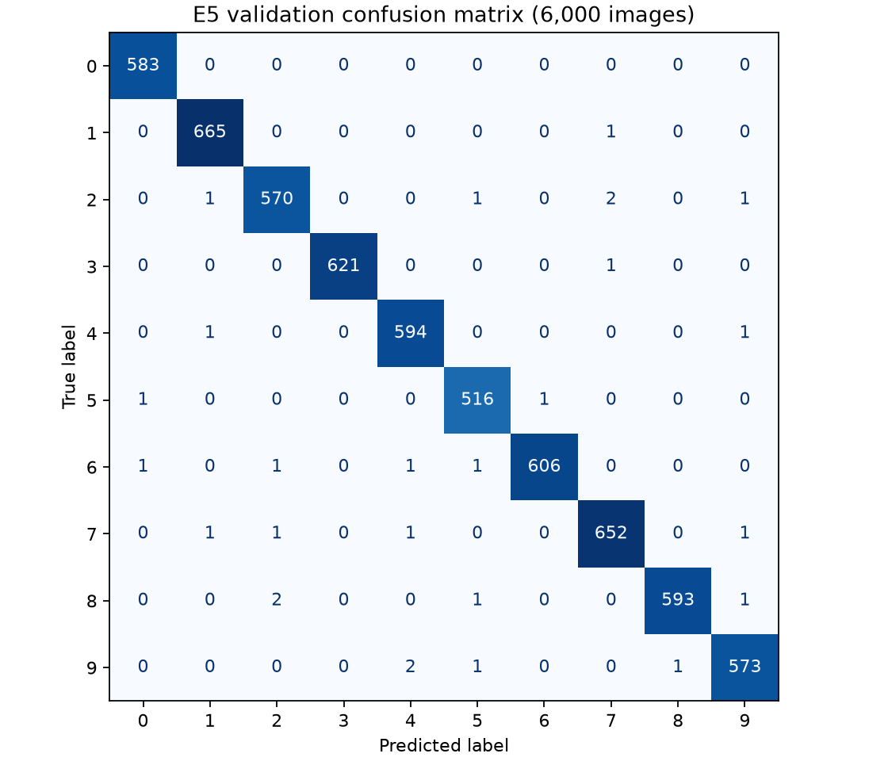
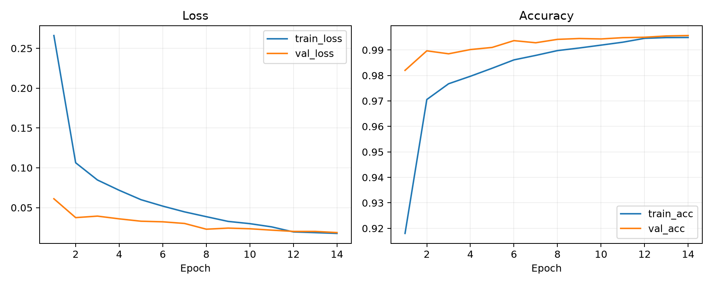
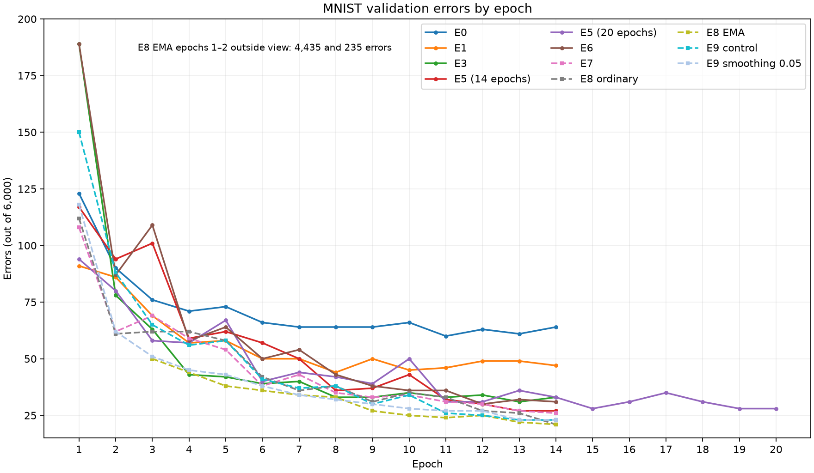
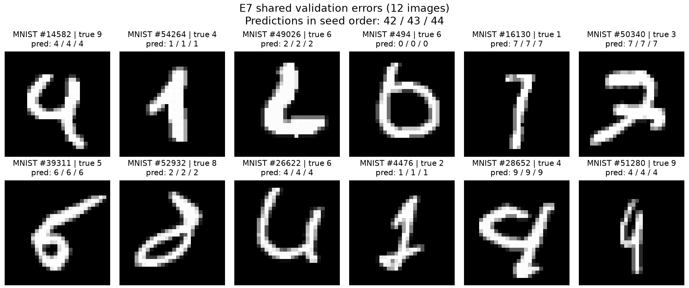

# MNIST 手写数字识别实验总结

**最终采用 E9 无标签平滑配置。** 它沿用 E7 的延后池化残差 CNN，使用普通交叉熵。训练种子 42、43、44 的官方测试准确率分别为 **99.70%、99.64%、99.68%**，平均 **99.6733%**。本次最高单次成绩是 E7 种子 42 的 **99.72%**，E7 的三种子平均为 **99.6233%**。

实验主线为 **E0 基线 → E1 仿射增强 → E3 小型残差 CNN → E5 优化配置 → E7 延后池化 → E9 标签平滑对照与最终选择**。下面按每一步的改动动机、实际改动和保留依据展开。

## 实验条件与选择规则

- 使用 Python 3.13.14、PyTorch `2.15.0+cu132`、Torchvision `0.29.2+cu132` 和 RTX 4060 Laptop GPU。
- 将官方训练集的 60,000 张图分成 54,000 张训练图和 6,000 张验证图，本文的对照使用划分种子 42。训练种子 42、43、44 用来复核初始化、批次顺序、随机增强及 Dropout 带来的波动。GPU 运算未强制完全确定。
- 正式训练前先检查一批 64 张图。输入形状为 `[64, 1, 28, 28]`，输出为 `[64, 10]`，单批前向、反向和参数更新均成功。
- 默认训练 14 轮、批量大小 64。每轮按验证准确率选权重，同分时选验证损失较低的轮次。选定权重后再记录官方 10,000 张测试图的结果。各实验使用同一个官方测试集，多种子统计反映的是不同训练运行在这批图片上的表现。

## E0 建立可比较的基线

**为什么做。** 先测出官方示例在自己的训练环境和数据划分下能达到什么水平。

**实际改动。** 从 PyTorch 官方两层 CNN 起步，使用 Adadelta 和 StepLR，训练 14 轮。网络输出对数概率，训练采用 NLLLoss。训练图仅做张量转换和归一化。

**结果与下一步。** 第 11 轮被选为最佳权重。验证集错 **60 张**，官方测试准确率 **99.13%**，错 **87 张**。随后保留网络和训练配置，测试增加数字写法变化能否减少错分。

*图 1。E0 的测试集混淆矩阵。行是真实数字，列是预测数字。例如第 7 行、第 2 列的 7 表示有 7 张真实为 7 的图被识别为 2。*

## E1 仿射增强与 E2 弹性形变

**为什么做。** 同一个数字可以写得偏一点、斜一点或大一点，训练时可以主动增加这类变化。

**实际改动。** E1 在 E0 基线上只给训练图增加随机仿射变换，包括旋转 ±10°、横纵平移约 2 像素、缩放 0.95～1.05。E2 用轻量弹性形变替换仿射增强，比较局部笔画变形和整图变换。验证图沿用基础预处理。

**结果与选择。** E1 的最佳验证错分从 **60 降到 44 张**，官方测试达到 **99.38%**，错 62 张。E2 验证错 53 张，后续保留 E1 的仿射增强。

## E3 用小型残差 CNN 替换原网络

**为什么做。** 数据增强确定后，我想试试用更多卷积层提取笔画特征。He 等人在 ResNet 原论文的图 1 中发现，在 CIFAR-10 上直接加深普通网络，56 层网络的训练误差和测试误差都高于 20 层网络。这个观察说明，单纯堆叠卷积层可能使网络更难优化。[ResNet 原论文，图 1](https://arxiv.org/pdf/1512.03385#page=1)

*原论文图 1。左图是训练误差，右图是测试误差，横轴是训练迭代数。红线代表 56 层普通网络，黄线代表 20 层普通网络。红线在训练集上的误差也更高，说明加深后连训练数据都更难拟合。E3 采用残差块来尝试加深特征提取网络。*

**原论文的结构依据。** 图 2 给出了残差块的两条路径。如果某几层只需要保留输入，卷积分支可以学到接近零的变化，让捷径把原特征传下去。第 3.2 节还说明了如何用投影对齐输入输出形状。[ResNet 原论文，图 2](https://arxiv.org/pdf/1512.03385#page=2) · [第 3.2 节](https://arxiv.org/pdf/1512.03385#page=3)

*原论文图 2。沿左侧看，输入 x 经过两层变换得到 F(x)。右侧弧线是捷径，直接传递 x。底部圆圈把两条分支相加，再经过 ReLU。E3 的第二个残差块需要改变通道数和空间尺寸，因此用 1×1 卷积和 BN 先对齐捷径形状。*

**实际改动。** 保留 E1 的增强和训练配置，用 Torchvision 的 `BasicBlock` 搭建适合 MNIST 的小型 CNN。E3 使用三个残差块，其中第二个块改变通道数和空间尺寸，捷径通过 `1×1` 卷积和 BN 对齐形状。新网络进入分类头的特征从 `64×12×12` 变成 `64×7×7`，第一层全连接的输入从 9,216 改为 3,136，隐藏层仍为 128，输出仍为 10 类。

**结果与选择。** 验证错分从 **44 降到 31 张**，测试达到 **99.57%**，错 43 张。总参数量从约 120 万降到 **553,450**，后续沿用这套结构。这里评价的是整套结构，卷积、BN 和残差连接各自的贡献没有单独测量。E4 只换训练种子为 43，验证错 38 张，用于观察同一配置的训练波动。

## E5 比较优化配置

**为什么做。** Loshchilov 和 Hutter 在 ResNet 图像分类实验中交叉比较了 Adam、AdamW 和不同学习率调度，为尝试 AdamW 搭配余弦退火提供了实验先例。[AdamW 原论文，图 1](https://arxiv.org/pdf/1711.05101)

**实际改动。** 保留 E3 的残差网络、增强、数据划分、训练种子、批量大小和 14 轮设置。优化配置从 Adadelta（初始学习率 1.0）加 StepLR，改为 AdamW（初始学习率 0.001、权重衰减 0.01）加余弦退火。

**结果与选择。** 验证错分从 **31 降到 27 张**，官方测试准确率从 99.57% 到 **99.60%**，错 40 张。这是整套优化配置的对照，差值无法分配给优化器、调度器或单个超参数。

*图 2。E5 第 13、14 轮的验证准确率均为 99.55%。第 14 轮验证损失更低，约为 0.02019，因此用第 14 轮的权重做测试。*

| E5 后续尝试 | 对照结果 | 后续选择 |
|---|---|---|
| 训练与余弦退火从 14 轮一并延长到 20 轮 | 验证错分从 27 张变为 28 张 | 沿用 14 轮配置 |
| E6 在 E5 的仿射增强上再叠加轻量弹性形变 | 8 张由错变对、11 张由对变错，净多错 3 张 | 保留仿射增强 |

## E7 从错分图片提出假设，再延后第一次池化

**为什么做。** E5 有些错分样本的短横、开口或笔画交接很难区分。第一次最大池化会把 28×28 缩到 14×14，池化窗口内的精确位置可能丢失。因此提出假设，让第一个残差块在下采样前先利用这些细节。错分图提供了提出假设的依据，具体笔画是否因此更容易识别，需要另做分析。

*图 3。每张图的标题按真实标签 → 模型预测排列。可以重点看第一排第三张 9 → 4 和第一排最后一张 1 → 7，分别观察开口和顶部短横。*

*图 4。E5 最佳权重在 6,000 张验证图上的混淆矩阵。图 1 是 E0 的官方测试集，样本划分不同。*

**实际改动。** 只把第一次最大池化从第一个残差块前移到块后。

- E5：入口卷积 → 最大池化（28×28 → 14×14）→ 第一个残差块。
- E7：入口卷积 → 第一个残差块（在 28×28 上处理）→ 最大池化（28×28 → 14×14）。

池化仍为 `MaxPool2d(2)`，默认 `ceil_mode=False`。后续 `14×14 → 7×7` 由第二个残差块的步长卷积完成。两者参数量均为 553,450，E7 的第一个残差块处理更大的特征图，计算量增加。

**结果与选择。** 固定仿射增强、AdamW、余弦退火和 14 轮训练，在相同 6,000 张验证图上做三种子配对比较。

| 训练种子 | E5 验证错分 | E7 验证错分 | E7 官方测试准确率 |
|---|---:|---:|---:|
| 42 | 27 | 26 | 99.72% |
| 43 | 28 | 27 | 99.66% |
| 44 | 24 | 24 | 99.49% |
| **平均** | **26.33** | **25.67** | **99.6233%** |

延后池化在两个种子下少错 1 张，另一个持平，验证收益很小。种子 42 的测试错分为 28 张，是本次最高单次成绩。E7 由此作为后续对照的结构基础。[E7 多种子测试记录](MNIST_E7多种子测试结果.json)

*图 5。E7 种子 42 的 14 轮训练曲线。最佳验证权重来自第 14 轮，验证损失约为 0.01869。*

## E8 与推理分支

| 对照 | 为什么试、做了什么 | 结果与选择 |
|---|---|---|
| E8 权重 EMA | 检查平滑参数能否改善结果。同一次训练维护普通权重和 EMA 权重，衰减系数 0.999，平均参数及 BN 缓冲区 | 三个种子普通权重分别错 21、26、25 张，EMA 错 21、23、26 张。一胜一平一负，普通权重保留为默认 |
| E3 平移 TTA | 同一份模型分别预测原图及上下左右各移动 1 像素的图，再平均类别概率 | 验证错 32 张，比 E3 单模型多错 1 张 |
| 早期等权集成 | 比较现有模型的错分能否互补 | E1 + E2、E1 + E3、E3 + E4 在验证集分别错 46、34、33 张，均未超过各自的最佳单模型 |
| E5 + E7 等权集成 | 让两种池化结构各预测一次，再平均类别概率 | 三个种子的验证集分别比 E7 少错 2、1、4 张。种子 42 的官方测试为 99.69%，错 31 张，比 E7 多错 3 张，保留单模型路线 |

E5 与 E7 集成在测试集上纠正了 E7 的 2 个错误，同时新增 5 个错误。[集成测试记录](MNIST_E5_E7集成测试.json)

## E9 对照标签平滑，确定最终配置

**为什么做。** 网络结构确定后，单独检查训练目标的变化能否进一步减少错分。

**实际改动。** 两组都沿用 E7 的结构、仿射增强和训练设置。网络输出原始类别分数，训练时用交叉熵，唯一比较项是标签平滑系数 `0` 与 `0.05`。验证损失统一用无平滑交叉熵。每个种子下两组都从头训练，先按验证集选权重，再评估官方测试集。

| 训练种子 | 无平滑验证错分 | 平滑验证错分 | 无平滑测试准确率（错分） | 平滑测试准确率（错分） |
|---|---:|---:|---:|---:|
| 42 | 23 | 23 | 99.70%（30） | 99.63%（37） |
| 43 | 26 | 20 | 99.64%（36） | 99.71%（29） |
| 44 | 21 | 23 | 99.68%（32） | 99.68%（32） |
| **平均** | **23.33** | **22.00** | **99.6733%（32.67）** | **99.6733%（32.67）** |

**结果与选择。** 标签平滑在官方测试上一胜、一平、一负，两组平均相同，最终采用 **E9 无平滑配置**。E9 的三种子平均比 E7 高 0.05 个百分点。普通交叉熵与 E7 的 `LogSoftmax + NLLLoss` 数学等价，差值无法归因于损失函数写法。[E9 多种子测试记录](MNIST_E9多种子测试结果.json)

## 错分分析与汇报重点

*图 6。实线为选取的早期实验，虚线为 E7、E8 普通权重与 EMA，以及 E9 无平滑与 0.05 平滑。各曲线使用训练种子 42，纵轴是同一批 6,000 张验证图中的错分数。为看清后期差异，纵轴上限为 200。E8 EMA 前两轮分别错 4,435 张和 235 张，超出显示范围，从第 3 轮起绘制。多种子和官方测试结果见各节表格。*

*图 7。E7 三个种子共同认错的 12 张验证图。true 是数据集标签，三个预测依次对应种子 42、43、44。*

在 6,000 张验证图中，5,958 张被三个模型都认对，19 张仅有一个模型认错，11 张有两个模型认错，12 张被三个模型共同认错。这 12 张里，三个模型对每张图都给出了同一个错误类别。例如标为 9、上半部有开口的样本被认成了 4。笔画相似性来自肉眼观察，仅凭图片无法确认标签是否有误。

汇报可重点展开 E7 和 E9。**E7** 展示如何从错分图提出结构假设，用单项改动和多种子验证来检验。**E9** 展示如何用同样的网络和训练配置比较损失函数，再根据三种子结果确定最终方案。讲成绩时分别标明 **E7 的单次 99.72%** 与 **E9 的三种子平均 99.6733%**。

## 参考与实验记录

- E0 的模型来自 [PyTorch 官方 MNIST 示例](https://github.com/pytorch/examples/blob/main/mnist/main.py)。
- E3 的结构依据见 [He 等人，ResNet 原论文](https://arxiv.org/abs/1512.03385)，残差块实现见 [Torchvision ResNet](https://github.com/pytorch/vision/blob/main/torchvision/models/resnet.py)。
- E5 的优化思路参考 [AdamW 原论文](https://arxiv.org/pdf/1711.05101)与 [SGDR 原论文](https://arxiv.org/abs/1608.03983)。
- 弹性形变与组合增强的思路参考 [Simard 等人的实验](https://www.cs.cmu.edu/~bhiksha/courses/deeplearning/Fall.2016/pdfs/Simard.pdf)与 [Cireșan 等人的 MNIST 实验](https://people.idsia.ch/~juergen/ijcai2011.pdf)。
- PyCharm 项目的各 `outputs*` 目录保留逐轮日志、最佳权重和评估记录。本文插图使用相对路径，移动报告时请一并移动 `MNIST实验图` 和同目录的评估 JSON。

