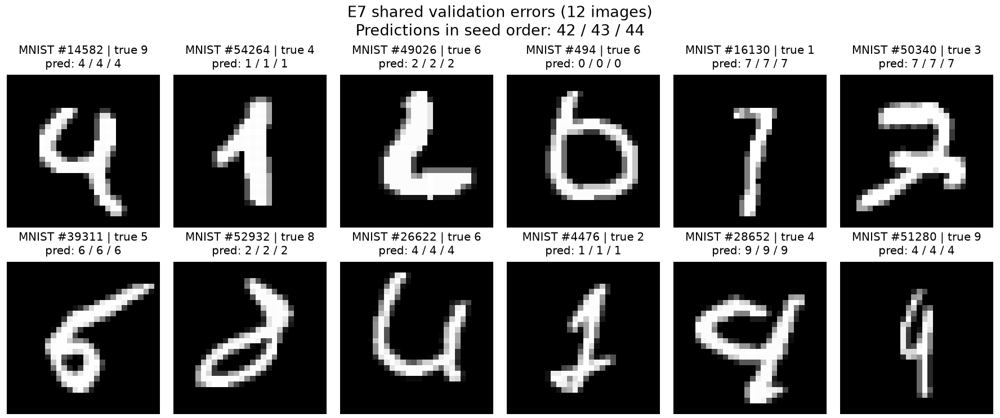

# MNIST 手写数字识别实验汇报讲稿

建议时长 6～8 分钟。每节对应一页或一组幻灯片，括号里的提示供汇报时使用。

## 第 1 页 实验目标

大家好，我今天汇报的是基于 PyTorch 的 MNIST 手写数字识别实验。我从一个两层卷积网络开始，逐步调整训练数据、网络结构和优化方法，最后用多个随机种子比较结果。

我主要讲三个问题。第一，基线怎么建立。第二，哪些改动带来了提升。第三，为什么最终选择 E9 无标签平滑配置，以及怎样理解它的 **99.6733%**。

## 第 2 页 数据和基线

MNIST 的输入是 28 乘 28 像素的灰度图，输出是 0 到 9 十个数字类别。实验把官方训练集的 60,000 张图固定分成 54,000 张训练图和 6,000 张验证图，另外使用官方的 10,000 张测试图。训练集用来更新参数，验证集用来选权重，官方测试集用来记录选定权重的测试成绩。

第一版 E0 采用 PyTorch 官方示例的两层 CNN。正式训练前，我用一批 64 张图检查了数据和输出的形状。输入是 `[64, 1, 28, 28]`，经过网络后输出 `[64, 10]`，对应每张图的十个类别。E0 最终在官方测试集上得到 **99.13%**，错分 87 张。这个结果是后续迭代的起点。

## 第 3 页 从数据增强到残差网络

第一步是 E1 的仿射增强。训练时，我给图片加小幅度的旋转、平移和缩放，让模型看到更多写法。验证和测试时使用原图。E1 的测试准确率提高到 **99.38%**。后来也试过弹性形变，也就是让笔画局部弯曲。E2 单独使用弹性形变，E6 则把较轻的弹性形变叠加到仿射增强上，两组都没有超过各自的仿射增强对照，因此后面沿用仿射增强。

接下来是 E3。我保留仿射增强，把原来的两层 CNN 换成小型残差 CNN。残差块会把卷积分支算出的特征和捷径分支相加。新结构同时缩小了送进全连接层的特征图，所以参数量从约 120 万降到 55 万，测试准确率达到 **99.57%**。这个结果对应整套结构的变化，单独哪一项贡献最大还没有做消融实验。

E5 保留了 E3 的网络、仿射增强、数据划分、训练种子、批量大小和 14 轮训练设置，把优化配置从 Adadelta 加 StepLR 换成 AdamW 加余弦退火，同时调整了初始学习率和权重衰减。E5 测试准确率为 **99.60%**，比 E3 的单次成绩高 0.03 个百分点。这组实验比较的是整套优化配置。要判断余弦退火单独的贡献，还需要固定 AdamW、初始学习率和权重衰减，只换调度器。后来我把训练和退火都延长到 20 轮，验证集多错 1 张，后续沿用 14 轮。

## 第 4 页 关键结构改动 E7

（这一页可以并排展示两条结构路线。）

- E5：入口卷积 → 最大池化 → 第一个残差块
- E7：入口卷积 → 第一个残差块 → 最大池化

我在错分图里看到，一些数字的区别集中在短横、开口或者笔画交接处。因此 E7 把第一次池化向后挪了一步，让第一个残差块先在 28 乘 28 的特征图上提取这些细节，再缩小到 14 乘 14。参数量保持在 **553,450**，第一个残差块的计算量会增加。

我用了三个训练种子做配对验证。每个种子下，E5 和 E7 各训练一次，使用同一批 6,000 张验证图。E7 相比分别少错 1 张、少错 1 张和持平。这个改动在验证集上有轻微优势。E7 种子 42 的官方测试准确率是 **99.72%**，这是本次实验的最高单次成绩。把三个种子的测试成绩放在一起算，E7 的平均是 **99.6233%**。

## 第 5 页 为什么最终选择 E9

（展示三种子结果表。）

| 训练种子 | E7 | E9 无平滑 | E9 标签平滑 0.05 |
|---|---:|---:|---:|
| 42 | 99.72% | 99.70% | 99.63% |
| 43 | 99.66% | 99.64% | 99.71% |
| 44 | 99.49% | 99.68% | 99.68% |
| 三种子平均 | 99.6233% | **99.6733%** | **99.6733%** |

E9 沿用 E7 的网络结构。我想知道标签平滑能不能再提高准确率，就给每个种子各训练两组。一组用普通交叉熵，另一组给其他类别分配少量目标概率，平滑系数设为 0.05。各组都先按验证集选出权重，再记录测试成绩。

结果是，标签平滑有一次赢、一次输、一次持平，三种子平均都是 **99.6733%**。因此最终采用 **E9 的普通交叉熵配置**。E9 的平均成绩比 E7 高 0.05 个百分点，其中较大的差异出现在种子 44。普通交叉熵与 E7 的 LogSoftmax 加 NLLLoss 在数学上等价，所以不能把这 0.05 个百分点归因于损失函数的写法。

## 第 6 页 错分分析与结论

（展示下面的共同错分图，挑两张指给听众看。）

图里的 12 张验证图片，三个 E7 模型都认错了，而且每张都猜成了同一个错误类别。比如左上角这张，标签是 9，但上半部有开口，三个模型都预测成 4。还有一张标签是 1，顶部有一小横，三个模型都预测成 7。这些图片让我看到，准确率已经接近 100% 时，剩下的错分常常要回到具体笔画来分析。

从两层 CNN 到最终配置，这次实验把官方测试成绩从基线的 **99.13%** 提高到 E9 三个种子平均 **99.6733%**。汇报里我分别记录了最高单次成绩和三种子平均，也保留了没有稳定提分的实验，方便以后判断哪些改动值得继续做。我的汇报到这里，谢谢大家。

## 备用页 其他对照和答疑

| 老师可能问 | 可以这样回答 |
|---|---|
| 为什么 E7 有 99.72%，最后还选 E9？ | 99.72% 是 E7 种子 42 的单次测试成绩。按相同三个种子比较平均成绩，E9 无平滑为 99.6733%，E7 为 99.6233%。差距很小，所以我报告实际数字，不把它解释为稳定的结构或损失优势。 |
| 固定种子控制了什么？ | 数据划分种子始终是 42，保证每次用同一批验证图。训练种子影响参数初始化、数据顺序、随机增强和 Dropout，实验中用了 42、43、44。 |
| EMA 和集成为什么没有留下？ | EMA 比较的是同一次训练的普通和平均权重，三个种子一胜一平一负。E5 和 E7 等权集成在验证集上有小幅收益，但种子 42 的测试错了 31 张，比 E7 单模型多 3 张。 |
| 延后池化是否开启了 ceil_mode？ | 没有。池化写的是 `MaxPool2d(2)`，使用默认的 `ceil_mode=False`，28 乘 28 刚好降到 14 乘 14。 |

完整实验配置与逐轮记录见 [MNIST 实验报告](MNIST实验总结.md)。

